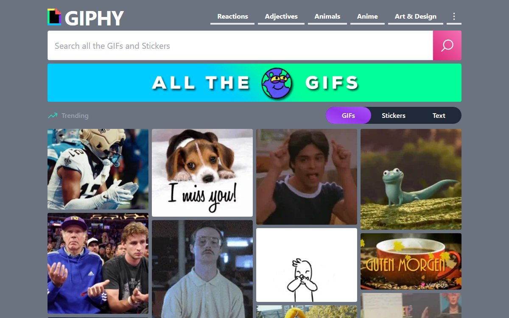

# GIPHY Clone

A GIPHY-style app for browsing trending GIFs, searching GIFs, stickers, and text, and saving favorites.

**Live:** https://giphy-clone.vercel.app · **[Product brief](docs/PRODUCT.md)** · **[Roadmap](https://github.com/josephvillanueva/GIPHY-Clone/milestone/1)**



## Features

- **Trending feed** on the home page
- **Search** with a GIFs / Stickers / Text filter that applies across pages
- **Category pages** at `/:category`
- **GIF detail pages** with related GIFs, plus share (native share sheet or copy link) and copy-embed-code
- **Favorites** survive reloads without an account. Optional email sign-in merges local favorites into a private account and syncs saves and removals across devices.
- **Favorites transfer links** preview a snapshot on another device and merge it only after the user chooses to import.
- Responsive layout for mobile and desktop

## Tech stack

- React 19 + Vite
- React Router (data router with a shared layout route)
- Tailwind CSS
- [`@giphy/js-fetch-api`](https://github.com/Giphy/giphy-js) for trending, search, category, and related-GIF requests

## How it's built

- **One shared context (`GifProvider`)** holds the GIPHY client, the active content-type filter, and favorites. The filter lives there so it carries over as you move between search, category, and home, without prop drilling.
- **Favorites store IDs, not GIF objects.** The Favorites page fetches current data in batches of 100. Signed-out favorites use the original `favoriteGIFs` localStorage key. Signed-in favorites use an account-specific cache and a durable queue of additions/removals. Refresh reads the account, and reconnecting retries pending changes. Account caches are never displayed to signed-out users or another account.
- **Routes are nested under one layout**, so the header and search bar mount once and the pages swap underneath.
- **One data hook (`useGiphy`) for every page.** Each request is keyed by all of its inputs (query, filter, GIF ID), so moving between two searches or two GIFs on the same route always refetches, and a response from a superseded request is discarded. Every page gets the same loading skeleton, error message, and retry. The retry button waits out the SDK's six-second cache of failed requests, since retrying sooner would only return the cached failure.
- **Deep links work on Vercel.** `vercel.json` rewrites every path to `index.html`, so refreshing or sharing a search, category, or GIF URL loads the app instead of a 404.

## Architecture


## Running locally

Requires Node 20+ and a free [GIPHY API key](https://developers.giphy.com/).

```bash
git clone https://github.com/josephvillanueva/GIPHY-Clone.git
cd GIPHY-Clone
npm install
echo "VITE_GIPHY_KEY=your_key_here" > .env
npm run dev
```

## Optional account sync setup

Without the two Supabase variables, browsing, local favorites, and transfer links work normally. To enable account sync:

1. Create a dedicated Supabase project and apply `supabase/migrations/20261021023822_favorites_ownership.sql` with the Supabase CLI or SQL editor. The table has a unique `(user_id, gif_id)` key, cascading user deletion, ID validation, and row-level policies for owner-only reads, inserts, and deletes. Anonymous access and updates are not granted.
2. Enable the email auth provider and retain the default magic-link email template. Configure the production Site URL and allow the exact `/favorites` callback for production and any intended development/preview origins. For example: `https://your-domain.example/favorites` and `http://localhost:5173/favorites`.
3. Copy `.env.example` to `.env.local` and set `VITE_SUPABASE_URL` and `VITE_SUPABASE_PUBLISHABLE_KEY` from that project. Use a public publishable key, never a service-role or secret key. Add the same public variables to the intended hosting environment and rebuild.
4. Configure production SMTP in Supabase Auth before relying on email delivery to arbitrary users. The default email service has recipient and rate restrictions. Test email delivery using an address you control.
5. Validate with two independent browser profiles: save locally, sign in, confirm the merge, save/remove a GIF, then sign in to the same account in the second profile and refresh. Test sign-out and a second account to confirm private favorites are hidden.

On first sign-in, guest favorites are inserted without duplicates. Guest IDs are cleared only after the account acknowledges them, preventing later sign-ins from resurrecting removed favorites. Account edits made offline are retained per account and retried on reconnect, visibility change, or **Retry sync**. Per-ID writes preserve additions made on other devices.

This repository does not provision or modify a live Supabase project automatically. Account sync must remain considered unactivated until the database, email delivery, hosting variables, and two-device flow have been verified together.

## Verification

```bash
npm test          # deterministic sync, race, persistence, and transfer tests
npm run test:sql  # real Postgres permissions and RLS in PGlite
npm run lint
npm run build
```

Transfer links contain GIF IDs, are visible to anyone who receives the URL, and do not update after creation. Opening a link only previews it. Links accept up to 1,000 valid IDs and invalid lists are rejected without importing anything.

## What I'd do next

- Infinite scroll on search and trending results
- Activate the optional Supabase integration and verify production email delivery and two-device sync
